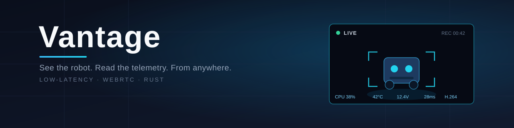

<p align="center">
  
</p>

# Vantage

Low-latency WebRTC system that lets an operator see a robot's live onboard camera
and system telemetry from anywhere (same LAN or remote), with a fleet-wide view of
how many robots are streaming and how many operators are connected. Single-language
Rust stack so message types are shared end to end with no drift.

See `openspec/` for the full specification and `docs/superpowers/plans/` for the
implementation plan.

## Workspace layout

| Crate                | Kind | Responsibility |
|----------------------|------|----------------|
| `vantage-protocol`   | lib  | Shared `serde` types: signalling messages, telemetry (`DeviceInfo`), ICE config, and a one-place codec wrapper (JSON now, `bincode` later). |
| `vantage-signalling` | lib  | Drives a `webrtcbin` peer and the coordinator WebSocket client; shared by robot and client. |
| `vantage-observability` | lib | Shared logging + OpenTelemetry (logs/metrics/traces) init; OTLP export when configured, stderr otherwise. |
| `vantage-coordinator`| bin  | Rendezvous service (axum): robot registration + heartbeat, client discovery, SDP/ICE relay, fleet stats, ICE-server provisioning. |
| `vantage-robot`      | bin  | GStreamer pipeline, telemetry producer; streams to clients over WebRTC. |
| `vantage-client`     | bin  | Operator console: discovers robots, connects, shows live stream + telemetry. |

## Prerequisites

### Rust

Rust 1.90+ (`rustup` recommended).

### System dependencies — GStreamer

`vantage-signalling`, `vantage-robot`, and `vantage-client` link against system
GStreamer via `pkg-config`. The `-dev` packages provide the `gstreamer-1.0`,
`gstreamer-webrtc-1.0`, and `gstreamer-sdp-1.0` pkg-config files the Rust crates
build against; `webrtcbin` lives in plugins-bad and ICE needs the `nice` plugin.

**Debian / Ubuntu:**

```bash
sudo apt-get install -y \
  libgstreamer1.0-dev \
  libgstreamer-plugins-base1.0-dev \
  libgstreamer-plugins-bad1.0-dev \
  gstreamer1.0-plugins-bad \
  gstreamer1.0-plugins-good \
  gstreamer1.0-plugins-ugly \
  gstreamer1.0-nice \
  libnice-dev \
  libfontconfig1-dev
```

> `vantage-protocol` and `vantage-coordinator` have **no** GStreamer dependency and
> build/test without these packages. Only the media crates require them.
>
> `gstreamer1.0-plugins-ugly` provides `x264enc`, the H.264 encoder the
> `vantage-signalling` tests and the `videotestsrc`/software-encode robot pipeline
> fall back to when no hardware encoder is present. `libfontconfig1-dev` is needed
> to build `vantage-client` (font rendering for the operator console UI).

**Raspberry Pi CSI camera (Camera Module, HQ Camera, etc.):** these run through
`libcamera`, not the legacy V4L2 stack, so `v4l2src` won't see them. Install the
libcamera GStreamer plugin and set `VANTAGE_VIDEO_SOURCE=libcamera`:

```bash
sudo apt-get install -y gstreamer1.0-libcamera
```

A USB webcam still works with the default `v4l2src` path
(`VANTAGE_VIDEO_SOURCE=camera`, `VANTAGE_CAMERA_DEVICE=/dev/videoN`).

If more than one CSI camera is attached, select one with `VANTAGE_LIBCAMERA_NAME`;
unset, `libcamerasrc` uses the first camera it detects. This must be the full
libcamera camera ID, not the sensor name shown in brackets — run
`rpicam-hello --list-cameras` and use the path in parentheses, e.g.:

```
0 : imx708_wide [4608x2592 10-bit RGGB] (/base/axi/pcie@1000120000/rp1/i2c@88000/imx708@1a)
```

`VANTAGE_LIBCAMERA_NAME=/base/axi/pcie@1000120000/rp1/i2c@88000/imx708@1a`

Verify the install:

```bash
pkg-config --modversion gstreamer-webrtc-1.0   # should print a version (e.g. 1.28.2)
gst-inspect-1.0 webrtcbin                       # should print element details
```

### Runtime: STUN / TURN

The coordinator hands ICE servers to peers. A public STUN server is used by
default. For the relay path (when no direct connection is possible) a TURN server
is required — for the PoC, the metered.ca free tier or a self-hosted `coturn`, both
with static credentials. The coordinator reads `VANTAGE_TURN_URL`,
`VANTAGE_TURN_USER`, and `VANTAGE_TURN_PASS` (see the table below) and serves them
over `/ice`.

See **[docs/turn-setup.md](docs/turn-setup.md)** for full metered.ca and coturn-on-a-VPS
setup, and the foundation plan for the forced-relay test.

## Build & test

```bash
# Protocol + coordinator only (no GStreamer needed):
cargo test -p vantage-protocol -p vantage-coordinator

# Everything (requires the GStreamer packages above):
cargo build --workspace
cargo test --workspace
```

## Run

```bash
# 1. Coordinator
RUST_LOG=info cargo run -p vantage-coordinator           # binds 0.0.0.0:8080

# 2. Robot (registers and waits for a client)
RUST_LOG=info VANTAGE_COORDINATOR=ws://localhost:8080 cargo run -p vantage-robot

# 3. Client (discovers, connects, shows telemetry)
RUST_LOG=info VANTAGE_COORDINATOR=ws://localhost:8080 cargo run -p vantage-client
```

### Coordinator environment variables

| Variable            | Default          | Purpose |
|---------------------|------------------|---------|
| `VANTAGE_BIND`      | `0.0.0.0:8080`   | Listen address. |
| `VANTAGE_TURN_URL`  | _(unset)_        | TURN server URL; when set, added to the ICE config handed to peers. |
| `VANTAGE_TURN_USER` | _(unset)_        | TURN username (static credential for the PoC). |
| `VANTAGE_TURN_PASS` | _(unset)_        | TURN credential. |
| `VANTAGE_COORDINATOR_TOKEN` | _(unset)_ | Shared bearer token (see [Security](#security) below). |

## SSH over WebRTC

Operators can SSH into a robot through the same WebRTC session that carries video
and telemetry, so `ssh`, `scp`, `rsync` and VS Code Remote work from anywhere the
client can reach the robot (coordinator + STUN/TURN, or the mDNS LAN path).

Each SSH connection gets its own reliable, ordered data channel labelled `ssh`.
The robot bridges it to its own `sshd`; the client exposes it to OpenSSH as a
`ProxyCommand`. SSH runs end to end, so authentication and encryption are plain
OpenSSH: robot host keys, your user keys, `known_hosts`.

**Robot** — off by default:

| Variable                   | Default        | Purpose |
|----------------------------|----------------|---------|
| `VANTAGE_SSH_ENABLE`       | _(unset)_      | `1` accepts SSH channels and advertises the `ssh` capability. |
| `VANTAGE_SSH_TARGET`       | `127.0.0.1:22` | Where tunnelled connections go. Fixed by the robot; operators cannot choose a destination. |
| `VANTAGE_SSH_MAX_CHANNELS` | `4`            | Concurrent SSH connections allowed per operator session. |

**Operator** — add to `~/.ssh/config` (with `VANTAGE_COORDINATOR` and, if set,
`VANTAGE_COORDINATOR_TOKEN` in the environment):

```
Host robot-*
  ProxyCommand vantage-client ssh-proxy %h
```

then `ssh robot-1` (the host name is matched against the robot id or name). The
proxy runs headless and logs only to stderr. Closing the WebRTC session drops
every SSH connection that rode on it.

**Hardening:**

- Keep strict host key checking on and distribute robot host keys (or an SSH CA)
  out of band. DTLS fingerprints travel through the coordinator in SDP, so the
  coordinator, or anyone holding its token, could intercept the WebRTC layer; the
  SSH host key check is what detects that.
- Use key-only auth (`PasswordAuthentication no`) and no root login. Binding
  `sshd` to loopback makes the data channel the only way in.
- `sshd` sees every tunnelled connection as coming from `127.0.0.1`; the robot logs
  the Vantage session id with each SSH channel open and close instead.
- Bulk copies share the link with video. On thin or TURN-relayed links, expect
  `scp` to lower video quality.

## Security

### Bearer-token auth

Set `VANTAGE_COORDINATOR_TOKEN` to require `Authorization: Bearer <token>` on every
coordinator route except `/healthz` (WS upgrades, `/ice`, `/stats`). Generate one
with `openssl rand -hex 32`. The robot and client read the same variable from
their own process environment and present it on the WS handshake and the `/ice`
fetch — no separate configuration needed on those binaries. Token comparison is
constant-time to avoid timing side-channels.

Leaving the token unset runs the coordinator **open**: any peer can register as a
robot, enumerate the fleet, open sessions, and fetch TURN credentials. The
coordinator logs a warning at startup in this case. See
[.env.example](.env.example) for setup, including a note on rotating TURN
credentials that were ever served by an unauthenticated `/ice` endpoint.

### DoS hardening

- **Message size cap** — WS messages/frames are capped at 64 KiB
  (`MAX_WS_MESSAGE_BYTES`); signalling payloads are a few KB, so anything larger
  is rejected at the transport level.
- **Bounded outbound queues** — each peer's outbound channel holds at most 256
  messages (`OUTBOUND_QUEUE_DEPTH`). A slow reader gets messages dropped with a
  warning log instead of growing coordinator memory without bound.
- **Idle-connection reaping** — a peer socket with no inbound frame for 20s
  (`PEER_IDLE_TIMEOUT`, well above the robot's 5s heartbeat) is treated as dead
  and torn down, freeing its registry/session/peer entries.

## Observability (OpenTelemetry → Grafana)

All three binaries emit structured **logs**, **metrics**, and **traces** through
`vantage-observability`. Export is opt-in: set `OTEL_EXPORTER_OTLP_ENDPOINT` to an
OTLP/gRPC collector and the process ships all three signals there; leave it unset
and behaviour is unchanged (plain `RUST_LOG` logging on stderr, no exporter).

```bash
# Export to a local collector / Grafana Alloy on the default OTLP gRPC port.
OTEL_EXPORTER_OTLP_ENDPOINT=http://localhost:4317 \
RUST_LOG=info VANTAGE_COORDINATOR=ws://localhost:8080 cargo run -p vantage-robot
```

Point `OTEL_EXPORTER_OTLP_ENDPOINT` at Grafana Alloy, the OpenTelemetry Collector,
or a Grafana Cloud OTLP endpoint — from there traces land in Tempo, logs in Loki,
and metrics in Prometheus/Mimir. Standard OTLP variables apply:

| Variable                      | Purpose |
|-------------------------------|---------|
| `OTEL_EXPORTER_OTLP_ENDPOINT` | OTLP/gRPC endpoint; **presence enables export** (e.g. `http://localhost:4317`). |
| `OTEL_EXPORTER_OTLP_HEADERS`  | Extra headers, e.g. Grafana Cloud `Authorization=Basic%20<base64>`. |
| `OTEL_SERVICE_NAME`           | Override the `service.name` (defaults to `vantage-<binary>`). |

Emitted metrics: `vantage.robot.{cpu_percent,mem_used_mb,mem_total_mb,uptime_s,temperature_celsius,frames_published}`,
`vantage.coordinator.{robots_online,sessions_active}`,
`vantage.client.{frames_received,telemetry_received}`.

For a ready-to-run Grafana Cloud setup — an OpenTelemetry Collector config and an
importable dashboard — see **[docs/observability/](docs/observability/)**.
